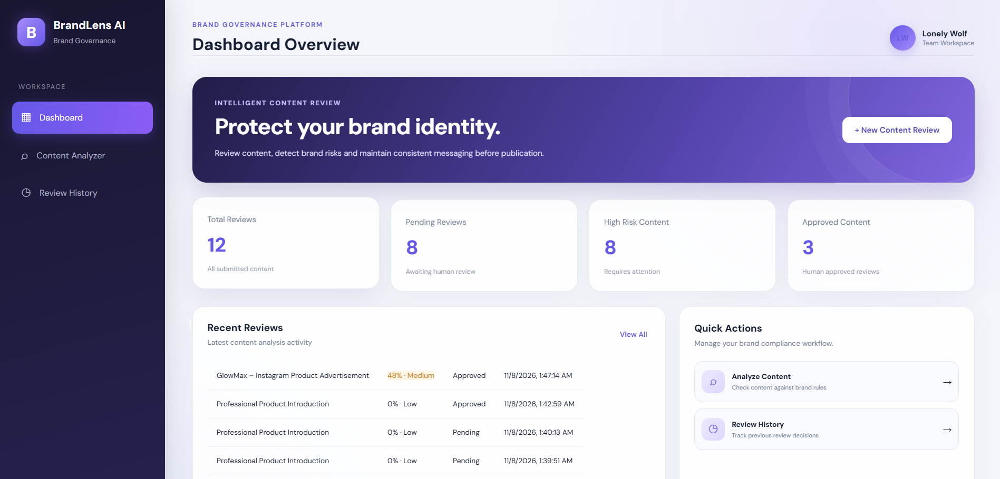
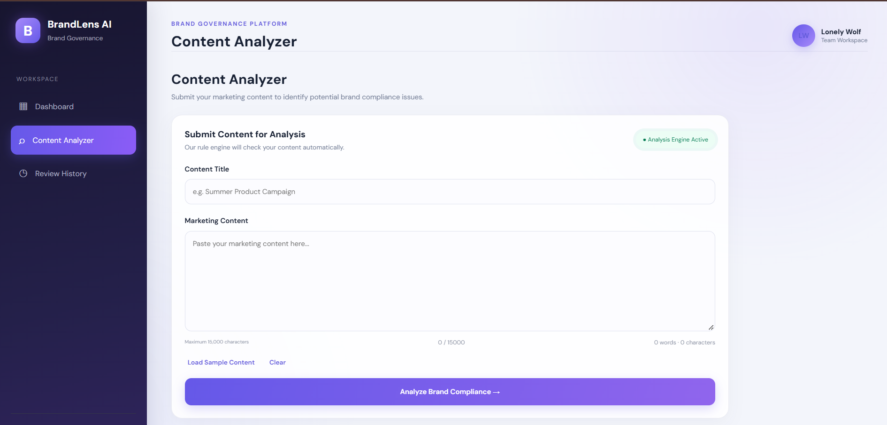
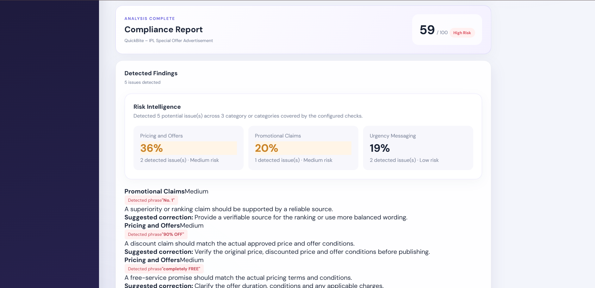
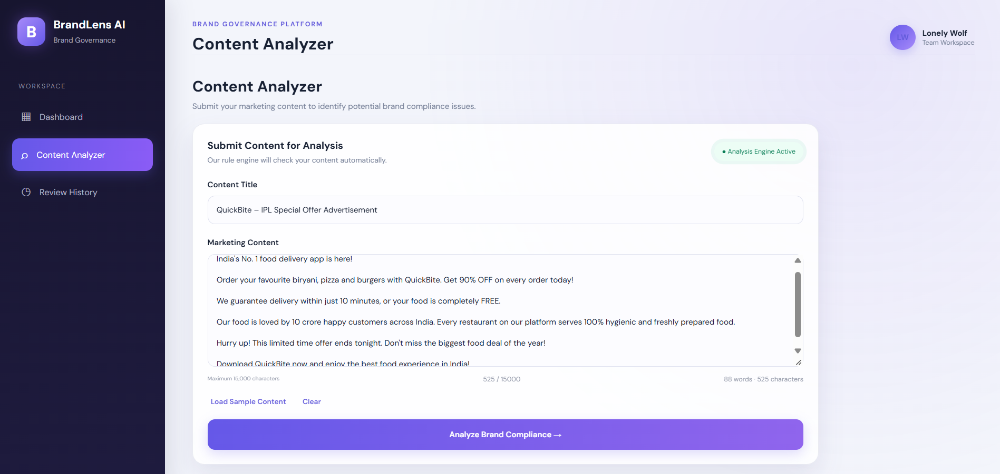
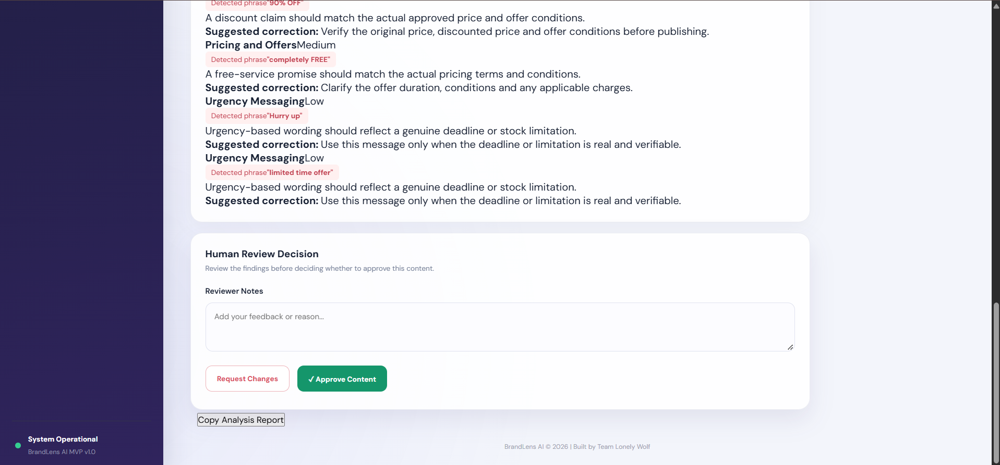
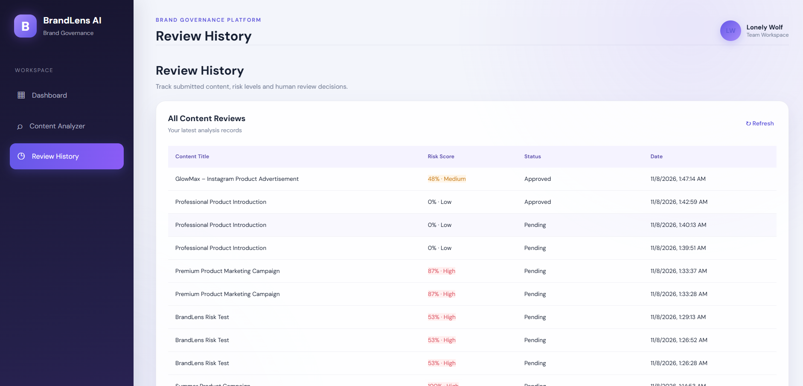

# BrandLens AI
### AI-Assisted Brand Governance & Content Compliance Platform

<p align="center">
  <strong>Protecting Brand Identity, One Content Check at a Time.</strong>
</p>

**Team:** Lonely Wolf  
**Project:** BrandLens AI  
**Submission:** Round 2 – The Build

---

## 1. Overview

BrandLens AI is a brand governance and content compliance platform designed to help businesses identify potentially misleading, exaggerated, unsupported, or inconsistent marketing content before publication.

The platform analyzes submitted content against configured brand-governance rules, identifies potential violations, calculates a heuristic risk score, and provides recommendations to support human review.

Its goal is to make brand-content checking more structured, transparent, and efficient.

## 2. Problem Statement

Businesses publish content across websites, advertisements, social media platforms, and other digital channels.

However, marketing content can contain:

- Unsupported or exaggerated claims.
- Misleading promotional statements.
- Unverified guarantees and promises.
- Aggressive urgency and sales language.
- Inconsistent brand terminology.

Manual content checking can be time-consuming and inconsistent.

BrandLens AI addresses this challenge through an organized content analysis, risk assessment, and human-review workflow.

## 3. Key Features

### Dashboard
- Overview of analyzed content.
- Review statistics.
- Risk and compliance information.

### Content Analyzer
- Submit marketing content for analysis.
- Detect configured content-governance rule violations.
- Highlight matched text.
- Display explanations and suggested corrections.

### Risk Assessment
- Calculate a heuristic risk score based on detected findings.
- Classify findings by severity.
- Display category-level risk information when applicable.

### Analysis Reports
- View detailed analysis results.
- Review detected issues and recommendations.

### Human Review Workflow
- Review analysis results.
- Approve or reject content.
- Add review notes.
- Track review decisions.

### Review History
- View previously analyzed content.
- Track review status and dates.
- Revisit saved analysis records.

## 4. Technology Stack

| Component | Technology |
|---|---|
| Frontend | HTML5, CSS3, JavaScript |
| Backend | Python, FastAPI |
| Database | SQLite |
| API | REST API |
| Server | Uvicorn |

## 5. How It Works

1. The user submits marketing content.
2. The backend checks the content against configured governance rules.
3. The system identifies matching phrases and potential issues.
4. A heuristic risk score is calculated using detected findings.
5. The frontend displays the analysis report and recommendations.
6. A human reviewer can approve or reject the content and add notes.
7. The review decision is saved and displayed in Review History.

## 6. Project Structure

```text
BrandLens_AI_Round2/
│
├── backend/
│   ├── main.py
│   └── requirements.txt
│
├── frontend/
│   ├── index.html
│   ├── styles.css
│   ├── premium.css
│   └── app.js
│
├── screenshots/
│   ├── dashboard.png
│   ├── contentanalyzer.png
│   ├── analysisreport.png
│   ├── ca_demoproblem.png
│   ├── fraud_claims.png
│   └── review-history.png
│
├── README.md
├── render.yaml
└── .gitignore
```

## 7. Installation and Setup

### Prerequisites
- Python installed.
- Visual Studio Code (recommended).

### Step 1: Open the project

Open the BrandLens_AI_Round2 project folder in Visual Studio Code.

### Step 2: Create a virtual environment

```bash
python -m venv .venv
```

### Step 3: Activate the virtual environment

**Windows PowerShell:**

```powershell
.\.venv\Scripts\Activate.ps1
```

### Step 4: Install dependencies

```bash
pip install -r backend/requirements.txt
```

### Step 5: Start the application

Run this command from the project root:

```bash
python -m uvicorn backend.main:app --reload
```

### Step 6: Open the application

Open the following URL in your browser:

http://127.0.0.1:8000

The FastAPI backend serves the frontend application.

API documentation:

http://127.0.0.1:8000/docs

## 8. API Endpoints

| Endpoint | Method | Purpose |
|---|---|---|
| `/api/health` | GET | Check backend health |
| `/api/analyze` | POST | Analyze submitted content |
| `/api/history` | GET | Retrieve review history |
| `/api/stats` | GET | Retrieve dashboard statistics |
| `/api/reviews/{id}` | GET | Retrieve a saved review |
| `/api/reviews/{id}` | PATCH | Update a review decision |

## 9. Application Screenshots

The following screenshots demonstrate the implemented application interface and its testing with different content scenarios.

### 9.1 Dashboard



### 9.2 Content Analyzer



### 9.3 Analysis Report



### 9.4 Real-Life Demo – CA Problem



### 9.5 Real-Life Demo – Fraud Claims



### 9.6 Review History



## 10. Current Implementation and Limitations

The current analysis engine uses configured pattern-matching rules and heuristic risk calculations.

- Findings are generated from configured detection rules.
- Risk scores are calculated using detected findings.
- Suggestions are provided to support content correction and review.
- Human reviewers retain control over approval and rejection decisions.

**Important implementation note:** The current version uses rule-based analysis and heuristic scoring. It is not yet a trained machine-learning model or a full large-language-model semantic analysis system.

The displayed risk score is an indicator based on detected findings, not a statistically validated probability of brand damage.

## 11. Future Improvements – Round 3

1. **Semantic AI Integration:** Introduce context-aware analysis to identify issues beyond predefined keyword and pattern matching.
2. **Custom Brand Guideline Profiles:** Allow organizations to configure their own brand voice, terminology, policies, and approved claims.
3. **Advanced Governance and Reporting:** Introduce improved reporting, explainability, and collaborative team-review capabilities.

## 12. Project Vision

Our vision is to help organizations maintain consistent, responsible, and trustworthy brand communication across digital platforms.

We aim to transform brand governance from a manual checking process into a more structured, intelligent, and transparent workflow.

---

### Developed by Team Lonely Wolf

**BrandLens AI – Protecting Brand Identity, One Content Check at a Time.**